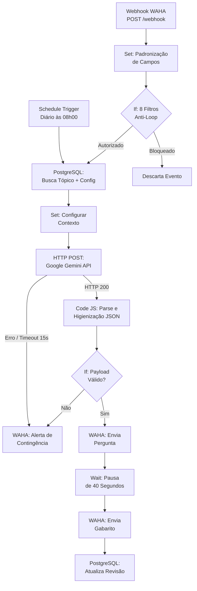
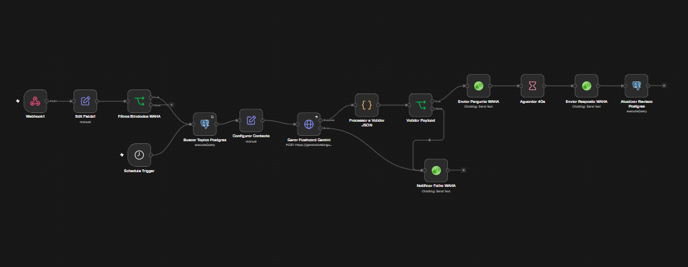

# 🧠 Orquestrador de Flashcards Temporizados para Revisão de Concursos


> Projeto prático final desenvolvido para a disciplina de **Automação e Programabilidade em Redes** — **UniSenac Campus Pelotas** (Prof. Wagner Loch).

---

## 1. Sobre o Projeto e Problema Resolvido

### A Dor Real
A preparação contínua para concursos públicos de alto nível na área de Tecnologia da Informação exige revisões diárias de conceitos teóricos extensos e multidisciplinares. O método mais eficaz para retenção de longo prazo envolve ler uma questão técnica objetiva e **escrever a resposta à mão no caderno** antes de conferir o gabarito. No entanto, elaborar perguntas inéditas todos os dias consome tempo útil de estudo, enquanto bots convencionais entregam pergunta e resposta simultaneamente, eliminando o esforço ativo de recordação (*active recall*).

### A Solução e o Ganho Prático
Esta automação atua em produção como um **tutor autônomo de estudos via WhatsApp**, integrando banco de dados relacional e Inteligência Artificial Generativa:
* **Rotação Inteligente de Conteúdo:** Consulta o PostgreSQL para selecionar automaticamente o tópico do edital que está há mais tempo sem revisão.
* **Geração Sob Demanda com IA:** Envia uma requisição REST para a API do Google Gemini solicitando uma questão objetiva e seu respectivo gabarito em formato JSON estruturado.
* **Janela Cronometrada de Escrita Manual:** Envia apenas a pergunta no WhatsApp e suspende a execução do fluxo por **40 segundos** (tempo calibrado para anotação manual no caderno) antes de disparar o gabarito e atualizar o histórico de revisões no banco.

---

## 2. Arquitetura e Fluxo de Funcionamento

O sistema opera de forma híbrida, permitindo tanto o disparo autônomo agendado diariamente quanto o acionamento sob demanda por meio de comandos enviados no chat privado do WhatsApp (`!card`, `/card`, `!flashcard` ou `/flashcard`).

### Diagrama de Fluxo de Dados



### Captura do Workflow no n8n



### Decisões Técnicas e Cumprimento dos Requisitos

1. **Blindagem de Eventos e Anti-Loop (`If` com 8 Regras):** Gateways de WhatsApp disparam múltiplos eventos de sistema, confirmações de leitura (`ack`) e mensagens de grupos. O nó condicional filtra rigorosamente o *payload* para aceitar apenas mensagens próprias (`from_me === true`), do tipo `message.any`, sem mídia (`hasMedia === false`), dentro de uma janela temporal de 120 segundos (evitando reprocessamento de *backlog* após reinício de containers), bloqueando grupos (`@g.us`), status (`status@broadcast`), canais (`@newsletter`) e exigindo comando exato via expressão regular.
2. **Manipulação Explícita de Dados Estruturados (`Code`):** O retorno da API do Gemini passa por um script em JavaScript que remove eventuais marcações Markdown, executa `JSON.parse`, valida a existência obrigatória das chaves `pergunta` e `resposta` e constrói dois *payloads* formatados distintos.
3. **Segurança e Proteção de Credenciais:** Nenhuma chave de API, senha ou número de telefone está exposto (*hardcoded*) no JSON do fluxo exportado. A autenticação com o Google Gemini utiliza **Header Auth** (`x-goog-api-key`) armazenado no cofre criptografado do n8n, e o identificador do destinatário (`chat_id`) é isolado na tabela `config_bot` do PostgreSQL.
4. **Resiliência e Tratamento de Falhas:** O nó HTTP Request possui *timeout* de 15 segundos e saída de erro dedicada (`Error Output`). Caso a API retorne códigos HTTP 4xx/5xx, sofra instabilidade de rede ou devolva JSON malformado, o fluxo desvia automaticamente para o nó de contingência e notifica o usuário no WhatsApp com o tópico pendente para revisão manual.

---

## 3. Tecnologias e APIs Utilizadas

| Camada | Tecnologia / Serviço | Protocolo / Finalidade |
| :--- | :--- | :--- |
| **Motor de Automação** | **n8n** (Self-Hosted) + **JavaScript** | Orquestração de fluxos, agendamento Cron, controle de estado (`Wait`) e *parse* de JSON. |
| **Gateway WhatsApp** | **WAHA** (WhatsApp HTTP API) | Recebimento de eventos via **Webhooks (HTTP POST)** e envio de mensagens via nó `n8n-nodes-waha`. |
| **Inteligência Artificial** | **Google Gemini API** | Consumo de API **REST/HTTPS** (`generativelanguage.googleapis.com`) com resposta estruturada (`application/json`). |
| **Banco de Dados** | **PostgreSQL** | Persistência relacional via **TCP/IP (porta 5432)** para controle de tópicos e parâmetros do bot. |
| **Infraestrutura** | **Docker & Docker Compose** | Containerização e isolamento de rede interna entre os serviços. |

---

## 4. Pré-requisitos e Como Executar

### Pré-requisitos
* **Docker** e **Docker Compose** instalados.
* Uma instância do **WAHA** rodando com uma sessão ativa autenticada via QR Code.
* Uma chave de API gratuita gerada no **Google AI Studio**.

### Passo a Passo para Instalação

**1. Clone o repositório e configure as variáveis de ambiente:**
```bash
git clone https://github.com/SEU_USUARIO/flashcards-temporizados-n8n.git
cd flashcards-temporizados-n8n
cp .env.example .env
```
> Edite o arquivo `.env` preenchendo suas credenciais locais do PostgreSQL e URLs de rede.

**2. Inicialize a estrutura do banco de dados PostgreSQL:**
Edite o arquivo `database/init.sql` substituindo `5553999999999@c.us` pelo seu identificador de chat no WhatsApp e execute o script no container do banco:
```bash
docker compose exec -T postgres psql -U n8n_user -d automation_db < database/init.sql
```

**3. Importe o workflow no n8n:**
1. Acesse a interface web do n8n (`http://localhost:5678`).
2. Crie um novo workflow, clique no menu **`...` (canto superior direito) → Import from File** e selecione `workflows/flashcards-n8n.json`.

**4. Configure as credenciais no cofre do n8n:**
* **Postgres account:** Host `postgres`, Database `automation_db`, Porta `5432` e usuário/senha definidos no `.env`.
* **Gemini API Key (`Header Auth`):** Crie uma credencial do tipo *Header Auth* com **Name:** `x-goog-api-key` e **Value:** sua chave do Google AI Studio.
* **WAHA account:** Configure a Base URL apontando para o container do WAHA na rede Docker (ex.: `http://waha:3000`) e sua chave de API.

**5. Ative o fluxo e conecte o Webhook:**
* Ative a chave **Active** no canto superior direito do workflow no n8n.
* No painel ou configuração da sessão do WAHA, aponte o webhook para `http://n8n:5678/webhook/webhook` com o evento `message.any` habilitado.
* Para testar imediatamente, envie **`!card`** na sua conversa pessoal do WhatsApp.

---

## 5. Demonstração (Resultados)

Abaixo está o registro real da execução completa: o disparo do comando `!card`, o recebimento imediato da questão, a espera de 40 segundos para escrita manual e a entrega automática do gabarito:


---

## 6. Melhorias Futuras (Roadmap)

* **Repetição Espaçada Adaptativa (Algoritmo SM-2):** Capturar respostas rápidas (`1` - Fácil, `2` - Médio, `3` - Difícil) enviadas após o gabarito para calcular dinamicamente a data da próxima revisão no PostgreSQL.
* **Relatório Semanal de Desempenho:** Adicionar um gatilho agendado aos domingos para consolidar via SQL os tópicos mais revisados e enviar um resumo estatístico no WhatsApp.
* **Ingestão Automatizada de Editais:** Criar um fluxo auxiliar capaz de ler editais em PDF e popular automaticamente a tabela `topicos_estudo` com os assuntos programáticos.